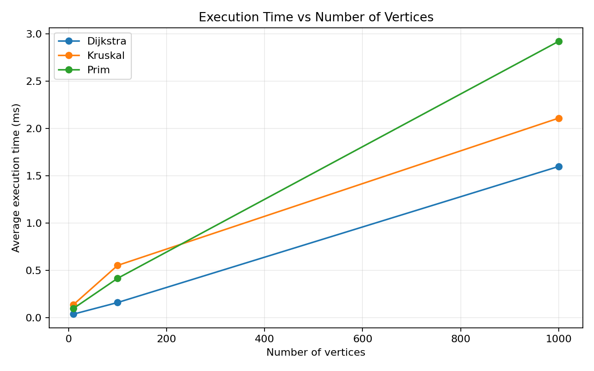
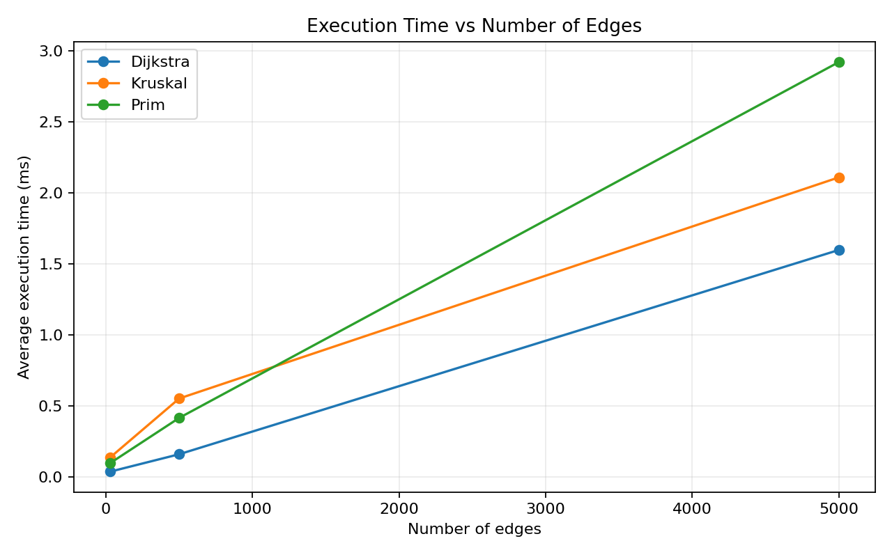

# Assignment 3 — Smart City Infrastructure and Route Planning

## Overview

This project models a smart city as a graph in Java. Vertices represent city districts or locations, edges represent roads or infrastructure connections, and edge weights represent construction cost or travel distance.

The project implements:

- Disjoint Set Union (DSU) with path compression and union by rank
- Kruskal's Minimum Spanning Tree (MST)
- Prim's MST using a priority queue
- Topological ordering with cycle detection
- Strongly Connected Components (SCC) using Kosaraju's algorithm
- Dijkstra's shortest-path algorithm
- Reproducible benchmarking and operation counting
- Automated correctness tests

The assignment requires the application to support infrastructure planning, connectivity analysis, and route planning, and requires the algorithms above to be implemented and compared. 

## Project Structure

```text
assignment-3/
├── src/
│   ├── graph/
│   │   ├── Edge.java
│   │   ├── Graph.java
│   │   └── DirectedGraph.java
│   ├── dsu/
│   │   └── DisjointSetUnion.java
│   ├── mst/
│   │   ├── MSTResult.java
│   │   ├── Kruskal.java
│   │   └── Prim.java
│   ├── connectivity/
│   │   ├── TopologicalSort.java
│   │   └── KosarajuSCC.java
│   ├── shortestpath/
│   │   ├── Dijkstra.java
│   │   └── ShortestPathResult.java
│   ├── benchmark/
│   │   └── BenchmarkRunner.java
│   └── tests/
│       └── TestRunner.java
├── results/
│   ├── tables/
│   │   ├── mst_results.csv
│   │   ├── directed_results.csv
│   │   └── dijkstra_results.csv
│   └── plots/
│       ├── execution_time_vs_vertices.png
│       └── execution_time_vs_edges.png
├── generate_plots.py
├── run.sh
└── README.md
```

## Implementation

### Graph representation

Undirected weighted graphs use adjacency lists. `Graph` also stores a separate edge list so that Kruskal can sort every undirected edge once. `DirectedGraph` stores outgoing adjacency lists and provides a reversed graph for Kosaraju's second DFS pass.

### DSU

`DisjointSetUnion` stores `parent` and `rank` arrays. `find()` uses path compression and `union()` uses union by rank. This prevents tall trees and makes a sequence of DSU operations very efficient.

### Kruskal

Kruskal sorts all edges by weight and repeatedly joins two previously disconnected components using DSU. The result contains the selected MST edges, total weight, connectivity status, and an operation count.

If fewer than `V - 1` edges are selected, the graph is disconnected and a spanning MST does not exist.

### Prim

Prim starts from vertex `0` and uses Java's `PriorityQueue` as a binary min-heap. The cheapest outgoing edge leading to an unvisited vertex is repeatedly selected until all reachable vertices are included.

For a connected graph, the result has `V - 1` edges. When multiple MSTs exist, Prim and Kruskal can select different edges but must have the same total weight.

### Topological ordering

Kahn's algorithm is used. The algorithm calculates indegrees, places all zero-indegree vertices into a queue, and repeatedly removes vertices while decreasing the indegree of their outgoing neighbors.

If fewer than `V` vertices are output, a directed cycle exists and a complete topological ordering is impossible.

### Strongly Connected Components

Kosaraju's algorithm performs two DFS passes:

1. DFS on the original graph records vertices by finishing time.
2. DFS on the reversed graph, processing vertices in reverse finishing order, extracts SCCs.

Every vertex belongs to exactly one SCC.

### Dijkstra

Dijkstra uses a binary heap priority queue and a predecessor array. The predecessor array allows the program to reconstruct the shortest path, not only the distance.

Unreachable vertices keep an infinite distance and return an empty path. Negative edge weights are rejected because Dijkstra's greedy finalization is not valid when negative edges can later improve an already-finalized distance.

## Complexity Analysis

The implementation uses adjacency lists. Prim and Dijkstra use Java's binary-heap `PriorityQueue`.

| Algorithm | Time Complexity | Space Complexity |
|---|---|---|
| DSU `find` / `union` | Amortized `O(α(V))` per operation | `O(V)` |
| Kruskal | `O(E log E)` | `O(V + E)` |
| Prim | `O(E log V)` | `O(V + E)` |
| Kosaraju SCC | `O(V + E)` | `O(V + E)` |
| Topological ordering | `O(V + E)` | `O(V)` besides graph storage |
| Dijkstra | `O((V + E) log V)` | `O(V + E)` |

### Effect of graph size

- **Kruskal:** increasing `E` increases the sorting cost because all edges must be ordered.
- **Prim:** increasing `V` and `E` increases heap and adjacency-list work.
- **SCC:** growth is approximately linear in `V + E` because the graph is traversed twice.
- **Topological ordering:** each vertex and edge is processed a constant number of times, giving `O(V + E)`.
- **Dijkstra:** larger graphs cause more relaxations and more priority-queue operations.

## Experimental Setup

The required graph configurations are:

| Configuration | Vertices (V) | Edges (E) |
|---|---:|---:|
| Small | 10 | 30 |
| Medium | 100 | 500 |
| Large | 1,000 | 5,000 |

A fixed random seed (`20261021`) is used so that graph generation is reproducible.

### Undirected MST graphs

For each size, a random spanning tree is generated first. Additional unique undirected edges are then added until the required number of edges is reached. This guarantees that the MST input graph is connected.

### Directed graphs

DAG edges are generated only from a lower-index vertex to a higher-index vertex. Therefore, a directed cycle cannot occur in the DAG input.

For the cycle test, one additional edge from the final vertex to vertex `0` is added. This creates a directed cycle while preserving the generated graph structure.

### Measurements

Each applicable algorithm is executed **five measured times**. Execution time is measured with Java's `System.nanoTime()` and averaged. A short unmeasured warm-up is performed before benchmark measurements to reduce JVM startup/JIT effects.

The benchmark also records relevant operation counts such as edge examinations, comparisons, DSU calls, and priority-queue processing.

## Running the Project

### Requirements

- Java 17 or newer
- Python 3
- Python package `matplotlib`

### One-command run on Linux/macOS

```bash
./run.sh
```

### Manual compilation

```bash
javac -d out $(find src -name "*.java")
```

### Run tests

```bash
java -cp out tests.TestRunner
```

Expected result:

```text
ALL TESTS PASSED: 24
```

### Run benchmarks

```bash
java -cp out benchmark.BenchmarkRunner
```

The benchmark writes CSV files into `results/tables/`.

### Generate plots

```bash
python3 generate_plots.py
```

The plots are saved in `results/plots/`.

## Results

The following measurements were obtained from the included benchmark run. Execution time is machine-dependent, so these values demonstrate the observed behavior of this implementation rather than universal hardware-independent timings.

### Kruskal vs. Prim

| Algorithm | V | E | Average time (ns) | Operations |
|---|---:|---:|---:|---:|
| Kruskal | 10 | 30 | 136,144 | 67 |
| Prim | 10 | 30 | 95,850 | 73 |
| Kruskal | 100 | 500 | 550,651 | 1,218 |
| Prim | 100 | 500 | 413,947 | 1,216 |
| Kruskal | 1,000 | 5,000 | 2,108,860 | 23,372 |
| Prim | 1,000 | 5,000 | 2,921,442 | 13,973 |

Kruskal and Prim returned the same MST weight on the connected benchmark graphs. Prim was faster for the small and medium graphs in this run, while Kruskal was faster for the large graph. The operation counts show that the algorithms perform different amounts of work despite both being efficient on sparse graphs.

### SCC and Topological Ordering

| Algorithm | Graph | V | E | Average time (ns) | Operations |
|---|---|---:|---:|---:|---:|
| SCC | DAG | 10 | 30 | 124,943 | 60 |
| Topological | DAG | 10 | 30 | 116,721 | 60 |
| Topological | Cyclic | 10 | 31 | 4,144 | 31 |
| SCC | DAG | 100 | 500 | 294,025 | 1,000 |
| Topological | DAG | 100 | 500 | 188,871 | 1,000 |
| Topological | Cyclic | 100 | 501 | 74,974 | 677 |
| SCC | DAG | 1,000 | 5,000 | 1,877,965 | 10,000 |
| Topological | DAG | 1,000 | 5,000 | 1,312,546 | 10,000 |
| Topological | Cyclic | 1,000 | 5,001 | 413,501 | 9,228 |

Kosaraju's operation count is approximately `2E`, which matches its two graph traversals. Topological sorting processes all available vertices and edges until either every vertex is ordered or the presence of a cycle prevents a complete ordering.

### Dijkstra

| V | E | Average time (ns) | Operations |
|---:|---:|---:|---:|
| 10 | 30 | 35,395 | 51 |
| 100 | 500 | 157,824 | 357 |
| 1,000 | 5,000 | 1,597,269 | 3,100 |

The measured Dijkstra time increases as graph size increases. The operation count also grows because more edges must be examined and more distance relaxations may be inserted into the priority queue.

### Required plots

#### Execution time vs. number of vertices



#### Execution time vs. number of edges



The raw benchmark data is stored in `results/tables/`, so the tables and plots can be regenerated.

## Comparison and Discussion

### Kruskal vs. Prim

Kruskal's main cost is sorting `E` edges, giving `O(E log E)`. Prim with a binary heap has `O(E log V)`. For the tested sparse graphs, both algorithms scale well. The benchmark demonstrates that practical performance depends on constants, memory access patterns, JVM behavior, and the exact amount of work performed.

### DSU optimization

Path compression reduces the depth of parent trees during `find()`. Union by rank attaches the smaller-rank tree below the larger-rank tree. Together these techniques give nearly constant amortized DSU operations and make Kruskal practical for large graphs.

### SCC

Kosaraju remains linear in `V + E`. The benchmark's operation counts grow from 60 to 1,000 to 10,000 for the three graph sizes, matching the fact that each edge is examined during each DFS pass.

### Topological ordering

The DAG cases produce a complete ordering. The cyclic cases fail to produce a complete ordering because at least one cycle prevents all vertices from reaching indegree zero. Both cases have linear theoretical complexity.

### Dijkstra

Dijkstra is appropriate when all edge weights are non-negative. It provides both shortest distances and actual paths. The priority queue makes the implementation suitable for sparse graphs. Negative edges are explicitly rejected because they can invalidate the greedy finalization rule.

## Testing

The test suite includes:

- small graphs
- disconnected graphs
- graphs containing cycles
- graphs with multiple valid MSTs
- graphs with unreachable vertices
- graphs containing duplicate edge weights
- a graph with a single vertex
- topological-order validity checks
- SCC partition checks
- Dijkstra distance checks
- Dijkstra path reconstruction
- rejection of negative edge weights

The test suite currently reports:

```text
ALL TESTS PASSED: 24
```

Important correctness checks include:

1. Kruskal and Prim return the same MST weight for connected weighted graphs.
2. Disconnected graphs are detected by both MST algorithms.
3. Every DAG receives a valid topological ordering.
4. Cyclic graphs are correctly rejected by topological sorting.
5. Every vertex belongs to exactly one SCC.
6. Dijkstra returns correct shortest distances for non-negative weights.
7. Unreachable vertices remain unreachable and have no reconstructed path.

## Conclusion
All required graph algorithms are implemented using adjacency lists.
The project implements the required graph algorithms for smart-city infrastructure planning and route analysis. MST algorithms minimize the cost of connecting districts, SCC and topological ordering analyze directed infrastructure dependencies, and Dijkstra finds shortest routes when edge weights are non-negative.

The benchmark framework provides reproducible graph generation, five timing repetitions, operation counts, CSV result tables, and two required plots. The tests verify the main correctness requirements and edge cases

